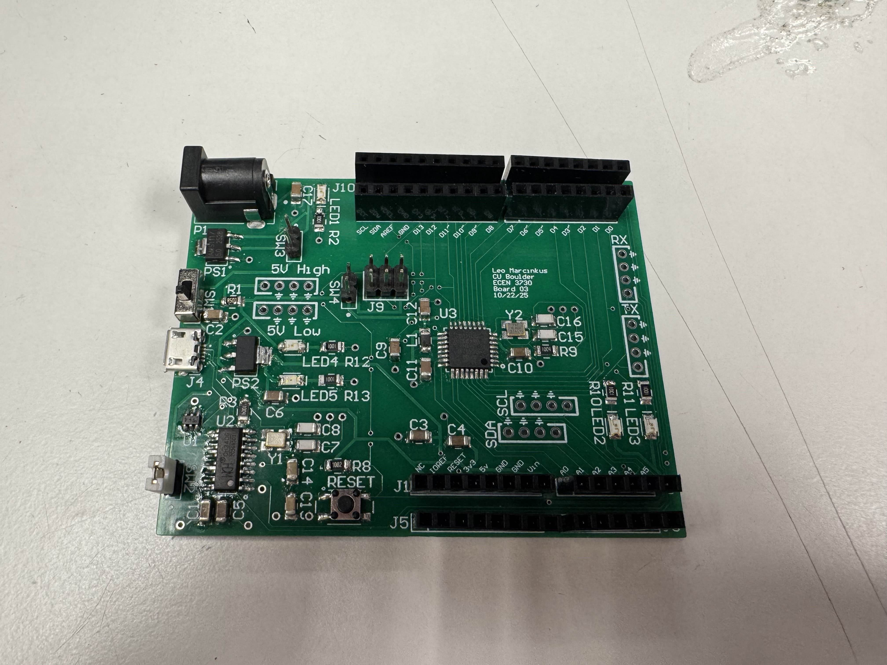
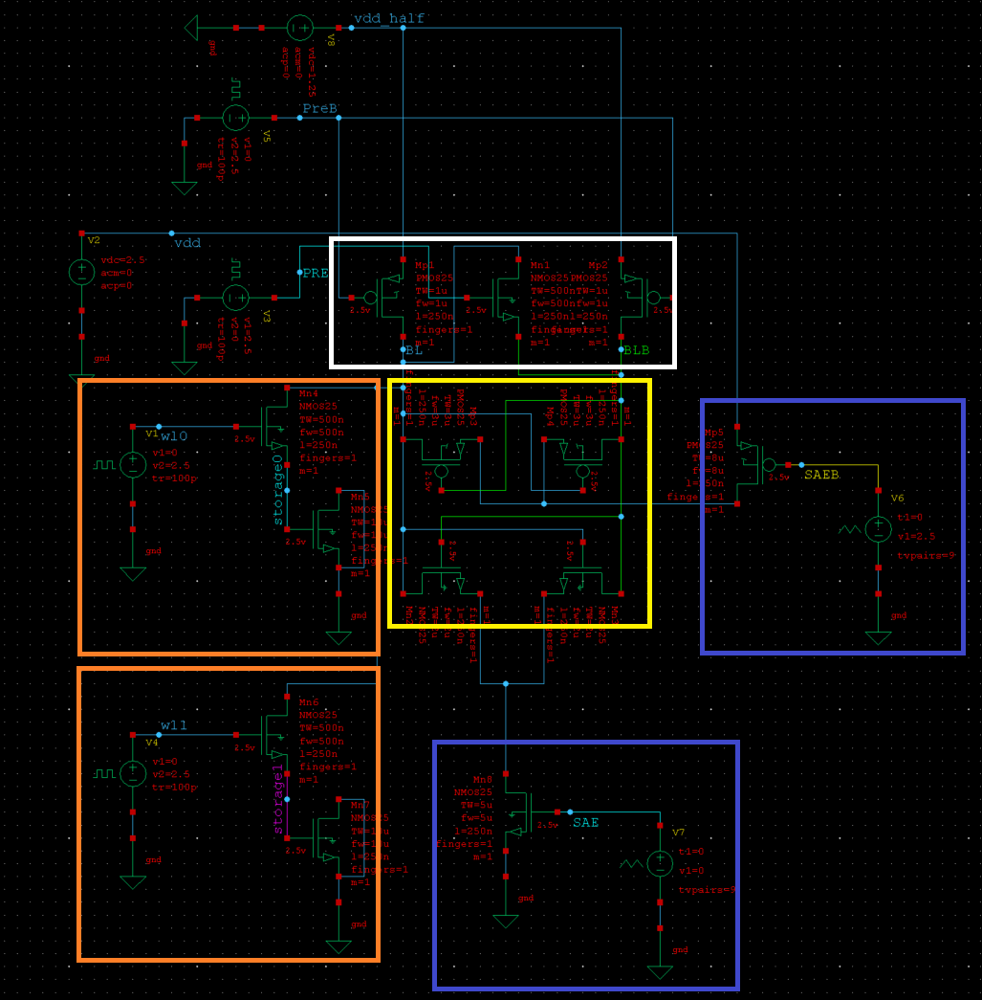
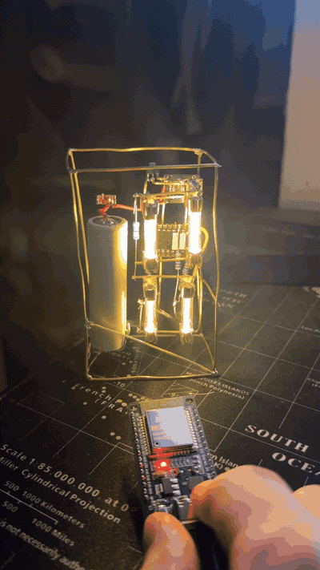
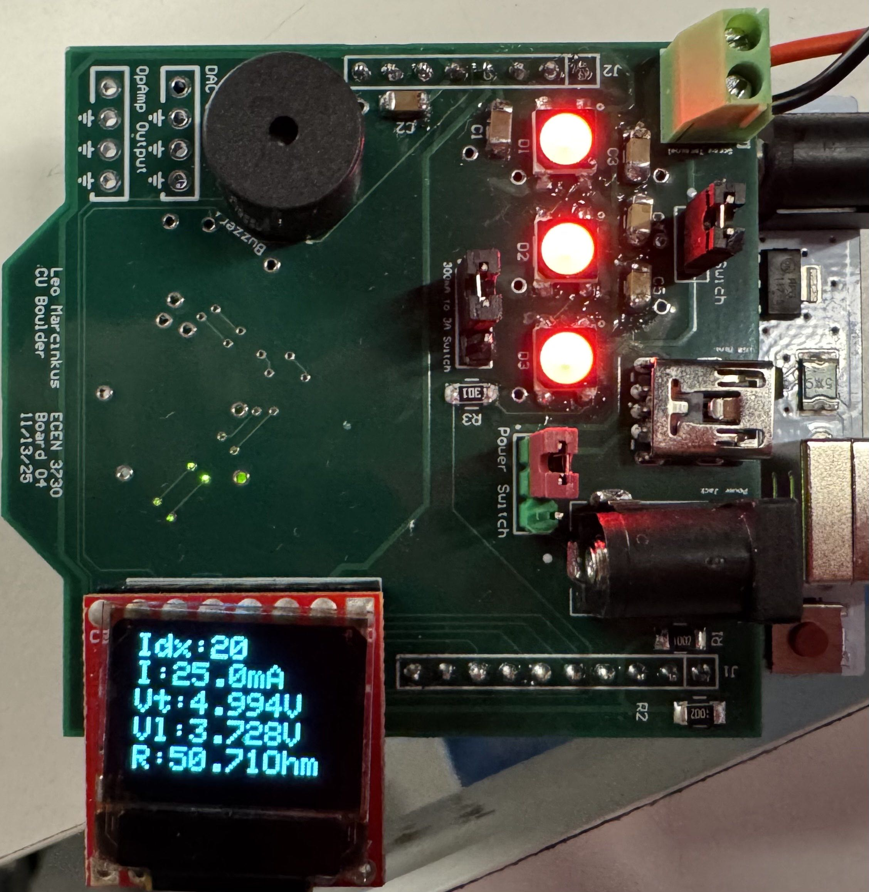

# Leo Marcinkus - Electrical Engineering Portfolio

This repository holds various curated engineering projects, lab reports,
and technical papers I've completed during my undergraduate and accelerated
master's studies in Electrical Engineering here at the University of Colorado Boulder.

I primarily focus on signal and power integrity, hardware design, and
custom IC design, with a large emphasis on hands-on measurement,
measurement-to-simulation correlation, and troubleshooting.

Currently a Software Test Intern on the HyperLynx QA team at Siemens EDA in
Boulder, working on signal integrity and power integrity workflow validation,
and a Research Assistant in Prof. Kelvin Wagner's photonic neuromorphic
systems group, working on in-pixel mixed-signal circuits.

▶️ Download Resume (PDF)
📄 [Leo Marcinkus - Resume](Leo-Marcinkus-Resume.pdf)

---

# Featured Project

## :zap: [Golden Arduino - Custom Arduino-Compatible Board](pcb-design/boards/board3/)
**PCB Design, Signal and Power Integrity, Altium**

  

A custom multi-layer ATmega328 board designed in Altium and benchmarked
against a stock Arduino Uno with an oscilloscope. Every layout decision was
verified by measurement: up to 1.7x lower ground bounce, 1.9x better on-die
supply isolation, 2.2x better isolation from external switching aggressors,
and 4.1x lower near-field emissions, from local decoupling placement,
tighter return paths, and via stitching.

📂 Project Folder
`pcb-design/boards/board3/`

---

## More Featured Projects :star:

### :star: [High-Speed Digital Measurement Labs](high-speed-digital/measurement-labs/)
**Signal Integrity, TDR, VNA, Keysight ADS, Graduate Coursework**

  

Six graduate labs (ECEN 5534, Prof. Eric Bogatin and Prof. Tim Swettlen)
pairing real scope, TDR, and VNA measurements with ADS and field-solver
models. Includes a VNA-based virtual TDR verified within 5% from 10 Ω to
1 kΩ, microstrip Z0 measured to ±0.4 Ω and compared against six tools,
and R-L-C models of resistive terminations showing loop inductance
growing from 2.6 to 9.0 nH with via distance. Fall 2026.

📂 Project Folder
`high-speed-digital/measurement-labs/`

---

### :star: [1T-1C DRAM Cell with Cross-Coupled CMOS Sense Amplifier](vlsi/dram-1t1c-sense-amplifier/)
**VLSI, Custom IC Design, Siemens Tanner**

  

A 13-transistor two-cell DRAM array designed, simulated, and laid out in Siemens
Tanner S-Edit, T-Spice, and L-Edit on a Generic 250 nm process at 2.5 V.
Measured a 57 mV pre-latch sense margin against a 50 mV target, with the latch
amplifying that to a 1.5 V resolved differential in about 300 ps. Full read
sequence verified including precharge, charge sharing, latching, and partial
refresh. ECEN 4012, Spring 2026.

📂 Project Folder
`vlsi/dram-1t1c-sense-amplifier/`

---

### :star: [Retro Glass Fuse Wireless Lamp](retro-fuse-lamp/)
**Embedded Systems, ESP32, Power Electronics**

  

A battery-powered lighting system built on ESP32 microcontrollers with
ESP-NOW wireless control, integrating Li-ion charging, power regulation,
and MOSFET LED switching into a compact hardware prototype.

📂 Project Folder
`retro-fuse-lamp/`

---

### :star: [Mixed-Signal VGA/AGC](vlsi/vga-agc-mixed-signal/)
**Mixed-Signal IC Design, Cadence Virtuoso, sky130**

A variable gain amplifier with automatic gain control built in Cadence
Virtuoso on sky130: custom 3-bit flash ADCs digitize the signal, its
amplitude, and a volume setting, a Verilog-A core computes the gain, and
a DAC and filter reconstruct the output. Simulated end to end in Spectre.
ECEN 4012, Spring 2026.

📂 Project Folder
`vlsi/vga-agc-mixed-signal/`

---

### :star: [Digitally Tuned AM Radio Receiver](rf-analog/digitally-tuned-am-radio/)
**RF and Analog Design, Measurement Characterization, Independent Study**

An AM receiver front end that replaces the mechanical variable capacitor with a
7-bit switched capacitor bank under Arduino control. Characterized end to end
with a Digilent AD3: resonance measured from 297 kHz to 561 kHz across the
tuning range, 154 pF of breadboard stray capacitance extracted from a baseline
sweep, and AM audio recovered out to roughly 10 kHz. Independent study under
Prof. Eric Bogatin, Spring 2026.

📂 Project Folder
`rf-analog/digitally-tuned-am-radio/`

---

### :star: [Instrument Droid - Measurement and Test Shield](pcb-design/boards/board4/)
**Mixed-Signal Design, System Integration**

  

Multi-function instrumentation shield integrating DAC, ADC, programmable load,
and OLED interface for Thevenin equivalent measurement and system validation.

📂 Project Folder
`pcb-design/boards/board4/`

---

### :star: [GAA Nanosheet FET Scaling Analysis](semiconductor-devices/research-reports/final-gaa-nanosheet)
**Semiconductor Devices, Research Analysis**

Technical research paper analyzing gate-all-around nanosheet transistor
architectures for advanced CMOS scaling beyond FinFET technology.

📂 Project Folder
`semiconductor-devices/research-reports/final-gaa-nanosheet/`

---

### :star: [Labyrinth - FreeRTOS Tilt Maze](embedded-systems/rtos-labyrinth-stm32/)
**Real-Time Embedded Systems, FreeRTOS, STM32F429**

A six-task FreeRTOS game with gyro-driven physics, mutex- and
event-flag-coordinated tasks, and SEGGER SystemView profiling (60% idle
headroom under worst-case load). Includes root-causing a PendSV hard
fault to an FPU-context stack overflow. ECEN 3753, Spring 2026.

📂 Project Folder
`embedded-systems/rtos-labyrinth-stm32/`

---

### :star: [STM32F429 Blackjack Touchscreen Game](embedded-systems/blackjack-stm32f429-project)
**Embedded Systems, C, HAL Drivers, Touch UI**

Custom embedded application developed on the STM32F429DISC-1 platform featuring
a touchscreen-based Blackjack game, interrupt-driven input, and modular firmware
architecture.

📂 Project Folder
`embedded-systems/blackjack-stm32f429-project/`

---

## Current Research (In Progress)

### In-Pixel Phase Detector and Liquid-Crystal Driver
**Mixed-Signal IC Design, X-FAB XS018 180 nm, Prof. Kelvin Wagner**

Research Assistant in a photonic neuromorphic systems group developing an
in-pixel CMOS circuit for a 25 x 25 µm pixel array on the X-FAB XS018
180 nm image-sensor process. Each pixel uses a dual-tap pinned photodiode
and an auto-zeroed comparator to detect the phase of modulated light, then
drives a liquid-crystal pad above the pixel.

- Designing the 1.8 V to 3.3 V level shifter and latch that holds each
  pixel's decision for a 1 ms frame and drives the 3.3 V XOR pad driver
- Set up the Siemens EDA custom IC flow (Custom IC, Calibre DRC/LVS) and
  licensing on a Rocky Linux VM for the group

Design files will be added as the work progresses.

---

## Project Areas

### [RF and Analog Design](rf-analog/)
Receiver front ends, tuned circuits, and measurement-driven analog
characterization.
`rf-analog/`

### [VLSI and Custom IC Design](vlsi/)
Full-custom schematic, simulation, and layout in Siemens Tanner and Cadence
Virtuoso, mixed-signal system design, and RTL-to-layout with Genus and
Innovus.
`vlsi/`

### [PCB Design and Hardware](pcb-design/)
Multi-layer PCB design, fabrication, and validation projects emphasizing
signal integrity and power integrity.
`pcb-design/`

### [High-Speed Digital & Signal Integrity](high-speed-digital/)
Scope, TDR, and VNA measurements correlated against ADS and field-solver
models, plus simulation of terminations, differential eye diagrams in
HyperLynx, and SerDes channel loss and FFE equalization.
`high-speed-digital/`

### [Semiconductor Devices](semiconductor-devices/)
Device characterization experiments and research papers covering diodes,
MOSFETs, photonics, and advanced CMOS architectures.
`semiconductor-devices/`

### [Electromagnetics, Waves, and Fields](electromagnetics-waves-fields)
Applied electromagnetic modeling and simulation projects.
`electromagnetics-waves-fields/`

### [Embedded Systems](embedded-systems/)
STM32 projects including a six-task FreeRTOS game profiled with SystemView
and a touchscreen application on the STM32F429.
`embedded-systems/`

---

## Tools and Technologies

- Programming/Analysis: C/C++, Python, MicroPython, SystemVerilog, Verilog-A, Tcl, MATLAB
- Embedded Platforms: STM32, Arduino, ARM Cortex-M, ESP32
- PCB and IC Design: Altium Designer, KiCad, Siemens Tanner (S-Edit, T-Spice, L-Edit), Siemens Custom IC, Calibre, Cadence Virtuoso, Spectre, Genus, Innovus
- Signal and Power Integrity: HyperLynx (SI, PI, AMS, Advanced Solvers), Keysight ADS, Ansys Q2D
- Simulation: LTspice, SIMetrix, SerDes Designer
- Measurement: Oscilloscopes, TDR, VNA, SMUs, logic analyzers
- Platforms: Linux (Debian, Arch, Rocky), Git

---

## Contact

- Email: leomarcinkus@gmail.com, leo.marcinkus@colorado.edu
- Phone: (630) 864-8802
- LinkedIn: https://linkedin.com/in/leo-marcinkus-a18062340
- Handshake: https://boulder.joinhandshake.com/profiles/leomarcinkus
- GitHub: https://github.com/Leo-Marcinkus

---
