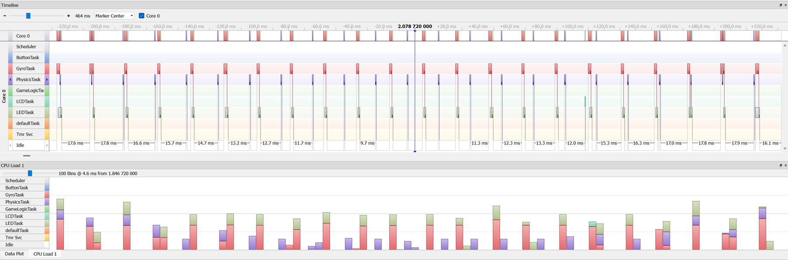
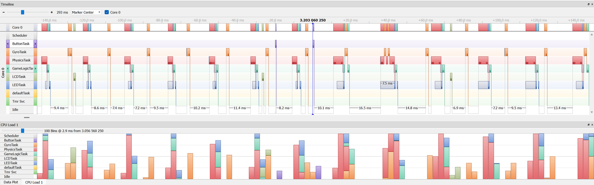

# Labyrinth - FreeRTOS Tilt Maze on STM32F429

**Course:** ECEN 3753 - Real-Time Operating Systems  
**Date:** Spring 2026  

## Overview

A tilt-controlled maze game on the STM32F429I-DISC1 running six FreeRTOS
tasks. Each reset generates a random 15 x 15 maze with walls, holes, and
waypoints, seeded from gyro noise. The gyro drives a physics simulation
of a "drone" that must reach three waypoints in order within 30 seconds.
A button-activated disruptor lets the drone pass through walls and holes
while its energy lasts.

  

## Technical Objectives

- Partition the game into real-time tasks with justified priorities
- Protect shared state with mutexes and coordinate tasks with semaphores
  and event flags
- Run a fixed-step physics simulation from live gyro data
- Profile scheduling and CPU load with SEGGER SystemView
- Account for code and memory usage on the target

## Task Architecture

| Task | Priority | Role |
|---|---|---|
| GyroTask | High | Reads the gyro every 20 ms |
| PhysicsTask | High | Gravity projection, velocity integration, wall collision, disruptor |
| ButtonTask | High | Semaphore-driven disruptor activation |
| LEDTask | Normal | Software PWM on the green LED for energy, red LED flash rate |
| LCDTask | Normal | Draws the maze once, then redraws only the drone at 10 Hz |
| GameLogicTask | Normal | Event-flag driven waypoints, win, and loss conditions |

Gyro and physics form a 20 ms pipeline and run at high priority so the
drone does not lag. LCD updates are slow over SPI, so LCDTask runs at
normal priority on a 100 ms period where it cannot block the physics loop.

## Results

- **CPU load, normal play:** idle 84.4%, GyroTask 7.7%, PhysicsTask 3.5%,
  LEDTask 3.5%
- **CPU load, disruptor active:** PhysicsTask rises to 19.2% from the
  wall pass-through loop and LCDTask to 5.3% from extra redraws; idle
  stays at 60.2%, with no missed periods

  

- **Memory:** 66.9 KB of flash (3.3% of 2 MB) and 176 KB of RAM. The
  240 x 320 LCD framebuffer is 153.6 KB of that; moving it to the board's
  external SDRAM would cut RAM use from 68.8% to about 10%
- **Schedule:** 45.0 hours actual against a 42.5 hour estimate (1.06x)

## Debugging Highlight

Every button press caused a hard fault. The GDB dump showed registers
filled with 0xA5A5A5A5 (the FreeRTOS stack fill pattern) and
LR = 0xFFFFFFF1, a fault in handler mode during PendSV. That pointed to a
stack overflow rather than a logic bug: LEDTask had a 256-byte stack,
while the Cortex-M4F FPU context save alone needs 204 bytes per context
switch. Raising LEDTask and GyroTask to 1024 bytes fixed it.

## Design Choices

- Physics dynamics and hole detection are pure functions with no RTOS or
  HAL calls, so they can be unit tested on a host (a 5 degree tilt gives
  854 mm/s² and 17.1 mm/s after one 20 ms tick)
- The configuration struct is const, so it lives in flash instead of RAM

## Tools

- STM32CubeIDE, FreeRTOS (CMSIS-RTOS2), C
- SEGGER SystemView, GDB
- STM32F429I-DISC1 with onboard gyro and ILI9341 LCD

## Files

- `Labyrinth_Report_Marcinkus.pdf` - Final report with timing, memory,
  and effort analysis  
- `images/` - SystemView timelines  

---

See also the [STM32F429 Blackjack touchscreen game](../blackjack-stm32f429-project/).
