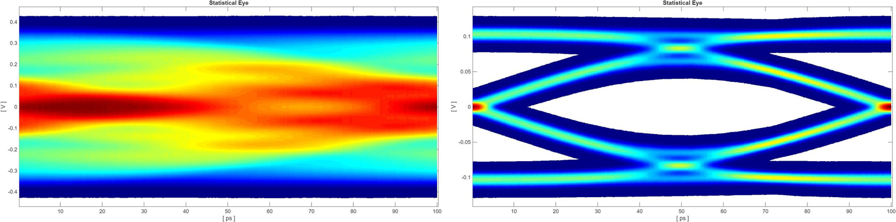
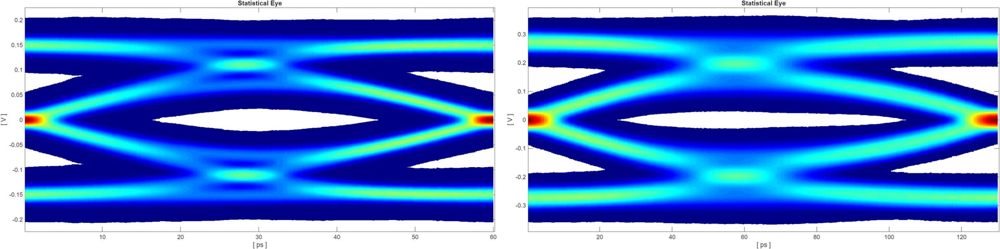
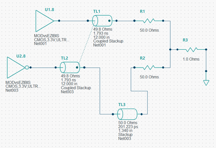
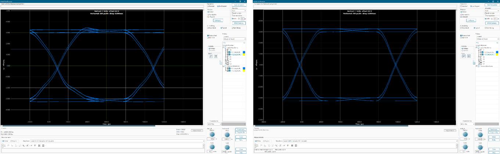

# High-Speed Digital Design Labs

**Course:** ECEN 5224 - High-Speed Digital Design  
**Date:** Spring 2026  

This directory contains lab reports from a graduate high-speed digital
design course, built around simulation in Keysight ADS, Siemens
HyperLynx, and SerDes Designer. The labs progress from single-ended
transmission lines and terminations to differential pairs, eye diagrams,
and equalized serial links.

  

## Featured Studies

### SerDes Channel Loss, Stubs, and Transmit FFE
`serdes-channel-loss-ffe.pdf`

NRZ serial links were simulated with statistical eye, PRBS waveform, and
pulse response for each case.

- At 10 dB insertion loss at the 5 GHz Nyquist frequency the eye is open;
  at 20 dB it closes completely from ISI
- A manually tuned transmit FFE (taps [0, 1.075, -0.6, 0, 0]) compressed
  the pulse tail and reopened the 20 dB eye (above)
- On measured 15-inch FR408 channels, the clean channel reached about
  16.7 Gb/s with FFE, while the same channel with a via stub reached only
  about 7.7 Gb/s. The stub creates a frequency null that removes signal
  energy, which FFE cannot recover

  

---

### Differential Pair Eye Diagrams in HyperLynx
`differential-pair-eye-diagrams.pdf`

  

- A 0.2 ns (1.34 in) length mismatch on one leg of a 100 Ω differential
  pair narrowed the 1 Gbps eye from 987.5 ps to 964.2 ps
- 100 Ω differential termination gave the cleanest eye (6.11 V, 990.2 ps),
  slightly better than 50 Ω per leg to ground (5.97 V, 988.4 ps)
- Sweeping the same 0.2 ns skew from 1 to 2.25 Gbps closed the eye as the
  skew grew from 20% to 45% of the bit period, showing that a mismatch
  acceptable at one data rate becomes a hard limit at a higher one

  

---

### TDR of Microstrip and Stripline, and Termination Schemes
`tdr-microstrip-stripline-terminations.pdf`

- ADS TDR gave 73.4 Ω for the microstrip and 43.3 Ω for the stripline,
  within the 73.5 to 74.5 Ω and 42.2 to 44.1 Ω ranges from Saturn PCB and
  Sierra Circuits calculators
- A 50 Ω line with a 10 Ω driver was simulated with clock, step, and
  single-bit-response stimuli under no termination, source series, far-end
  to ground, and far-end to Vtt termination, comparing ringing and
  steady-state levels

## Additional Studies

### Transmission Line and Via Impedance Matching
`transmission-line-impedance-matching.pdf`

Lumped L and C approximations compared against ideal transmission line
models to find the valid operating range for each approach.

### Time- and Frequency-Domain Analysis of High-Speed Signals
`time-frequency-domain-prbs-analysis.pdf`

Spectral content of ideal and non-ideal square waves and multi-gigabit
PRBS signals, showing how rise time sets bandwidth requirements.

### Decoupling Capacitor Resonance and Transient Response
`capacitor-srf-decoupling.pdf`

Parallel decoupling networks and realistic capacitor models, showing how
ESL and ESR set self-resonance, voltage droop, and ringing.

### Reflections and Source/Load Impedance
`reflections-source-load-impedance.pdf`

Six combinations of source (3, 50, 950 Ω) and load (50 Ω, 1 MΩ)
impedance on an ideal 50 Ω line, showing when reflections ring and when
they are absorbed.

### Rise Time and S-Parameters vs Line Length
`rise-time-vs-line-length.pdf`, `s-parameters-vs-line-length.pdf`

| Length | Output rise time (10 ps input) | S21 at 8 GHz | S11 at 8 GHz |
|---|---|---|---|
| 6 in | 72 ps | -3.46 dB | -43.79 dB |
| 12 in | 123 ps | -6.85 dB | -25.93 dB |
| 24 in | 275 ps | -13.67 dB | -24.63 dB |
| 36 in | 373 ps | -20.49 dB | -24.56 dB |

Insertion loss scales roughly linearly with length, and the edge slows
in step with it, on a 50 Ω microstrip in ADS.

## Tools and Methods

- Keysight ADS: transient, TDR, and S-parameter simulation
- Siemens HyperLynx: stackup, coupled lines, IBIS drivers, eye diagrams
- SerDes Designer: statistical eye, pulse response, transmit FFE
- Touchstone (.s4p) channel models

## Files

- `serdes-channel-loss-ffe.pdf`
- `differential-pair-eye-diagrams.pdf`
- `tdr-microstrip-stripline-terminations.pdf`
- `transmission-line-impedance-matching.pdf`
- `time-frequency-domain-prbs-analysis.pdf`
- `capacitor-srf-decoupling.pdf`
- `reflections-source-load-impedance.pdf`
- `rise-time-vs-line-length.pdf`
- `s-parameters-vs-line-length.pdf`
- `images/` - Figures from the reports

---

For measurements on real hardware, see the
[ECEN 5534 measurement labs](../measurement-labs/).
