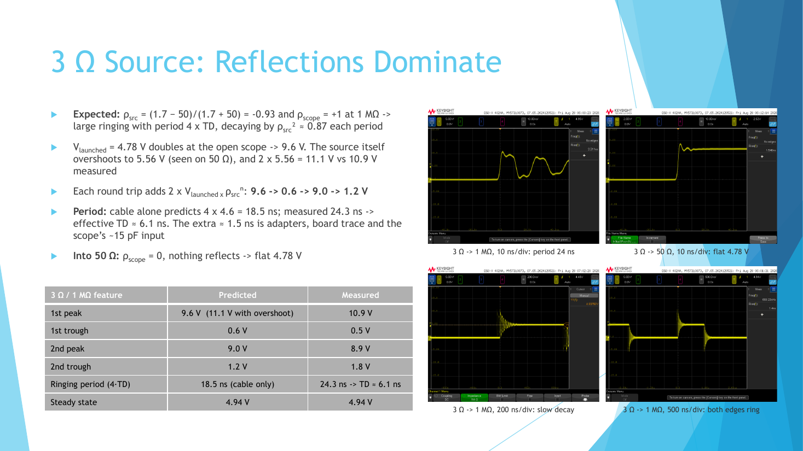
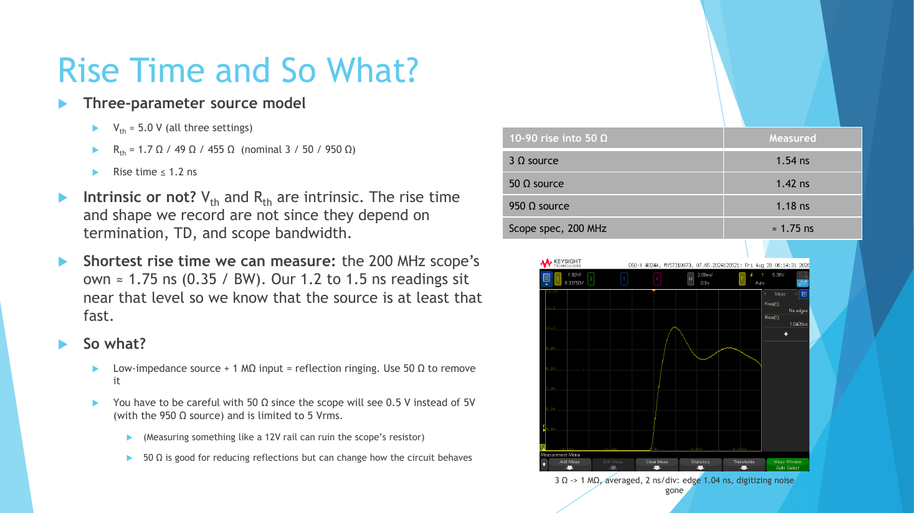

# Lab 1.1 - Ringing in Cables and Scope Terminations

**Course:** ECEN 5534 - High-Speed Measurements  
**Date:** Fall 2026  

## Overview

This lab measured how a fast digital edge behaves on a 3 ft RG58 coax
cable when the source impedance and the scope termination change. A 555
timer driving a hex inverter at 5 V was switched through series resistors
of nominally 3 Ω, 50 Ω, and 950 Ω, and each source was measured into both
the 1 MΩ and 50 Ω scope inputs, giving six configurations.

Every waveform was read through a Thevenin source model and a lossless
transmission line, so each feature on the scope could be predicted before
it was measured.

  

## Technical Objectives

- Extract the Thevenin voltage and source resistance of each source setting
- Predict reflection coefficients at the source and the scope
- Predict ringing amplitude, period, and decay from the line delay
- Separate cable reflections from other ringing mechanisms
- Determine the shortest rise time the setup can resolve

## Setup

- Scope: Keysight DSOX4024A, 200 MHz, 8-bit vertical resolution,
  input switched between 1 MΩ and 50 Ω
- Interconnect: 3 ft RG58 coax (Z0 = 50 Ω, velocity factor 0.66,
  TD ≈ 4.6 ns) with an SMA-to-BNC adapter
- Source: 555 timer driving a hex inverter at 5 V through a 3 Ω, 50 Ω,
  or 950 Ω series resistor

## Method

The source resistance was extracted from the steady-state voltage into
the open (1 MΩ) and loaded (50 Ω) inputs:

Rth = 50 x (Vth / VL - 1)

The extracted Rth then set the source reflection coefficient, and the
measured ringing was compared against a bounce-diagram prediction.

## Results

| Source setting | Vth (1 MΩ) | VL (50 Ω) | Rth extracted |
|---|---|---|---|
| 3 Ω | 4.94 V | 4.78 V | 1.7 Ω |
| 50 Ω | 5.00 V | 2.53 V | 49 Ω |
| 950 Ω | 5.03 V | 0.50 V | 455 Ω |

- **3 Ω source:** ρsrc ≈ -0.93 against an open scope produced strong
  ringing. Predicted peaks of 11.1, 0.6, and 9.0 V matched measured values
  of 10.9, 0.5, and 8.9 V. The 24.3 ns ringing period gave an effective TD
  of 6.1 ns, about 1.5 ns longer than the cable alone because of the
  adapters, board trace, and the scope's ~15 pF input.
- **50 Ω source:** matched to the line, so a single 5 V step into 1 MΩ and
  a flat 2.53 V into 50 Ω (2.50 V predicted), with no reflection ringing.
- **950 Ω source:** ρsrc ≈ +0.80 produced a stepped rise with steps 2·TD
  apart. The measured step ratio of 0.80 independently confirmed the
  extracted 455 Ω, showing the "950 Ω" position was actually ≈ 460 Ω.
- **Residual ~5 ns ring on every 50 Ω capture:** the period does not match
  any cable round trip and appears regardless of source resistance, so it
  was attributed to supply rail ringing rather than a reflection.
- **Rise time:** 1.2 to 1.5 ns measured, close to the scope's own
  ≈ 1.75 ns limit (0.35 / 200 MHz), so the source is at least that fast.

  

## Key Takeaways

- A low-impedance source into a high-impedance load rings at 4·TD and
  decays by ρsrc² each period, which is predictable from three numbers:
  Vth, Rth, and TD
- A 50 Ω scope input removes reflections but also loads the circuit, so
  it can change what is being measured
- Vth and Rth are intrinsic to the source; the recorded rise time and
  waveform shape are not, because they depend on termination, line delay,
  and scope bandwidth
- When a feature does not fit the reflection model, the period is the
  fastest way to identify what else is causing it

## Files

- `Lab1.1_Marcinkus.pdf` - Final presentation with all scope captures  
- `images/` - Key slides  

---

Part of the [ECEN 5534 measurement labs](../).
