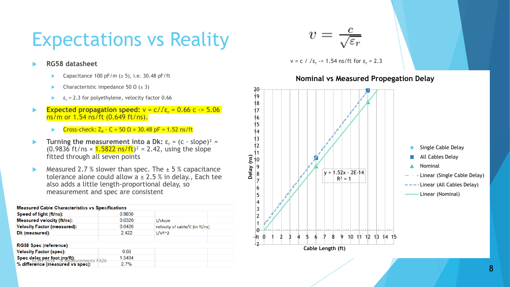
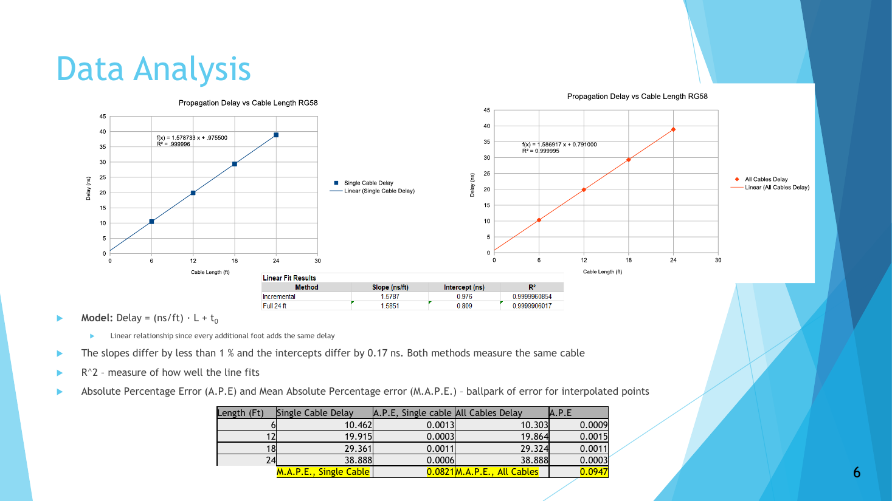

# Lab 1.2 - Time of Flight in Coax Cables

**Course:** ECEN 5534 - High-Speed Measurements  
**Date:** Fall 2026  

## Overview

This lab measured the propagation delay of RG58 coax as a function of
length, separated the delay of the cable from the delay of the fixture,
and turned the measured velocity into a dielectric constant.

Two independent methods were used so that the delay-vs-length result did
not depend on how the cables were assembled.

  

## Technical Objectives

- Measure delay vs cable length from 6 ft to 24 ft
- Separate the per-foot delay (slope) from fixture delay (intercept)
- Cross-check two measurement methods against each other
- Extract the effective Dk of the cable and compare it to the datasheet
- Quantify the measurement uncertainty

## Setup

- Scope: Keysight DSOX4024A with two 10x probes, compensated on the
  calibration signal and plugged into BNC Tees through probe-to-coax
  adapters
- Interconnect: 4 x 6 ft RG58 (Z0 = 50 Ω) lengths with SMA-to-BNC
  adapters and BNC Tees, far end open
- Source: 555 timer driving a hex inverter at 5 V through the 3 Ω output
- Channel-to-channel skew adjusted to -77.5 ps with both probes on the
  same edge

## Method

Channel 1 at the launch Tee was the trigger and reference. Delay was
measured 50% to 50% from Channel 1 to Channel 2 with 128 averages.

- **Incremental:** Channel 2 at the open end, adding one 6 ft cable at a
  time up to 24 ft
- **All connected:** all 24 ft in place, Channel 2 moved Tee to Tee at 6,
  12, and 18 ft

Each data set was fit to Delay = (ns/ft) · L + t0.

## Results

| Length | Incremental delay | All-connected delay |
|---|---|---|
| 6 ft | 10.462 ns | 10.303 ns |
| 12 ft | 19.915 ns | 19.864 ns |
| 18 ft | 29.361 ns | 29.324 ns |
| 24 ft | 38.888 ns | 38.888 ns |

- **Slope:** 1.58 ns/ft, with the two methods agreeing to better than 1%
  and both linear fits giving R² ≈ 1
- **Intercept:** t0 ≈ 0.8 to 1.0 ns, about 7 inches of cable, coming from
  the adapters, Tees, and probe adapters before the cable. The two methods
  differ by 0.17 ns here, while the slope is unchanged
- **Dk:** εr = (c · slope)² = 2.42 vs 2.3 for polyethylene. The measured
  delay is 2.7% slower than the datasheet's 1.54 ns/ft, which is inside
  the ±5% capacitance tolerance plus the small per-Tee delay
- **Consistency checks:** a mid-cable Tee read ≈ 4.8 V, matching the
  launched voltage from Lab 1.1, and the open end read ≈ 7 V where the
  reflection adds. The 6 ft reflection returned at ≈ 21 ns, or 2 x 10.46 ns

  

## Key Takeaways

- The slope is a property of the cable; the intercept is a property of
  everything in between. Two lengths cannot separate them, four can
- Assuming zero delay at zero length hides about a nanosecond of fixture
- At 1.58 ns/ft, a 100 ps skew budget is only 0.76 in of this cable, and
  every connector costs roughly 0.2 to 0.4 ns, which is why length
  matching in differential pairs matters

## Files

- `Lab1.2_Marcinkus.pdf` - Final presentation with scope captures and fits  
- `images/` - Key slides  

---

Part of the [ECEN 5534 measurement labs](../).
