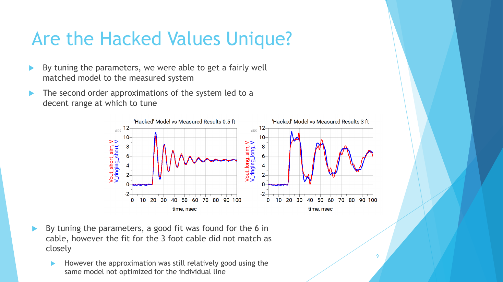
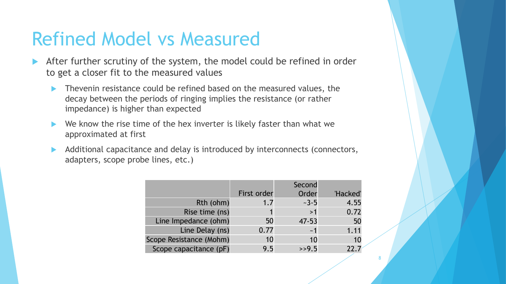
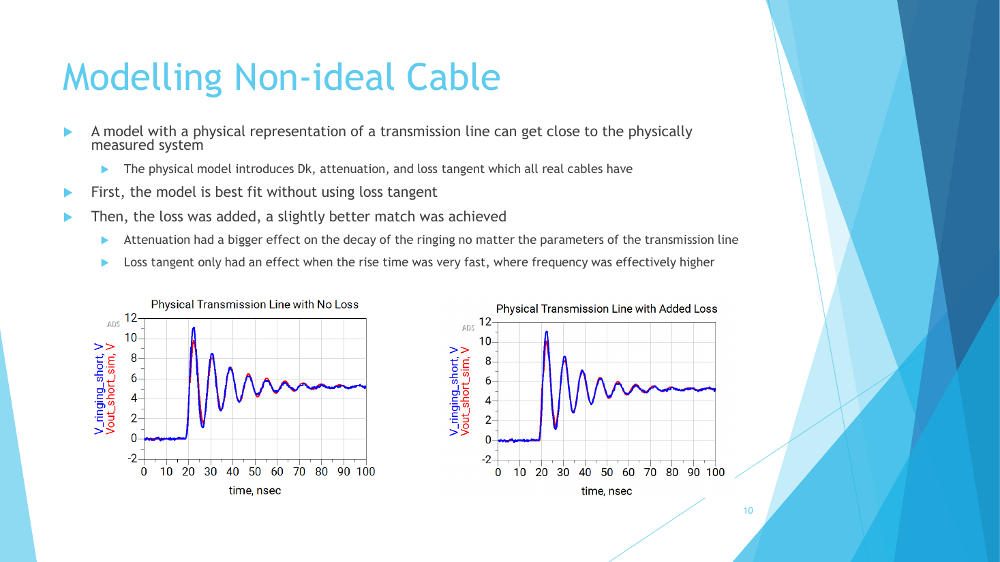

# Lab 1.3 - Hacking Ringing Reflections in Coax Cables

**Course:** ECEN 5534 - High-Speed Measurements  
**Date:** Fall 2026  

## Overview

This lab took measured ringing waveforms from two lengths of the same
coax cable, imported them into Keysight ADS, and built a circuit model
that reproduces them. The model started from nominal values based on
datasheets and earlier labs, then was refined and "hacked" until the
simulation matched the measurement. A final step replaced the ideal line
with a physical lossy transmission line.

  

## Technical Objectives

- Capture clean ringing waveforms on 0.5 ft and 3 ft RG58 cables
- Import the scope data into ADS as a dataset source
- Build a model with a Thevenin source, ideal transmission line, and the
  scope's input impedance
- Compare the nominal model against the measurement, then refine it
- Test whether the fitted values are unique, and add physical cable loss

## Setup and Measurement

- Source: Board 100, 3 Ω output at 5 V, driving RG58 coax into the scope's
  1 MΩ input with no probe
- Scope: Keysight DSOX4024A, 5 GSa/s, 200 MHz, 50 ns/div for both cables
  so the two data sets share one time base
- Trigger: rising edge at 1.13 V with holdoff (1.16 µs for 3 ft, 0.96 µs
  for 0.5 ft), which puts the start of the edge just before t = 0 since
  ADS only plots t ≥ 0
- 2000 points at 0.25 ns per sample saved as CSV, with the time base long
  enough to show the steady state

## Measured Ringing

| Feature | 0.5 ft | 3 ft |
|---|---|---|
| 1st peak / steady state | 11.09 V / 5.24 V | 11.11 V / 5.22 V |
| Ring period | 8.3 ns | 24.5 ns |
| Effective TD (period / 4) | 2.1 ns | 6.1 ns |
| Cable-only TD (1.54 ns/ft) | 0.77 ns | 4.6 ns |
| Extra delay (fixture and scope) | 1.3 ns | 1.5 ns |
| Rsrc from decay | 3.7 Ω | 3.0 Ω |

The difference between the two cables gives (6.1 - 2.1) ns / 2.5 ft =
1.6 ns/ft. Both cables carry about 1.3 to 1.5 ns of extra delay from the
SMA-BNC adapter, connectors, and the scope's input capacitance and
resistance. The decay rate implies an effective source resistance of 3 to
4 Ω, above the 1.7 Ω DC value from Lab 1.1, because a lossless model has
to put the cable loss somewhere.

## Bringing the Waveforms into ADS

- Scope CSV headers replaced with an MDIF block header, with time shifted
  so every sample is at t ≥ 0
- Converted to an ADS dataset with the Data File Tool (generic MDIF)
- Played back through a VtDataset source tied to ground through a dummy
  resistor so no node floats
- Transient run from 0 to 500 ns with the step fixed at 0.25 ns, matching
  the scope sample interval

The imported waveform has to look exactly like the scope screen before
any model is added.

## Edge Type

Linear, cosine, and erf edges were simulated with the same rise-time
setting to see how each maps to a 10-90 rise time. The erf edge best
replicates a real channel but costs more to simulate. Its 10-90 rise time
corresponds to a constant K of about 2.22 to 2.3, compared with 1.69 for
cosine and 1.25 for linear.

## Nominal, Refined, and Hacked Models

  

| Parameter | Nominal | Second order | Hacked |
|---|---|---|---|
| Rth | 1.7 Ω | ~3 to 5 Ω | 4.55 Ω |
| Rise time | 1 ns | under 1 ns | 0.72 ns |
| Line impedance | 50 Ω | 47 to 53 Ω | 50 Ω |
| Line delay | 0.77 ns | ~1 ns | 1.11 ns |
| Scope resistance | 10 MΩ | 10 MΩ | 10 MΩ |
| Scope capacitance | 9.5 pF | >> 9.5 pF | 22.7 pF |

- **Nominal:** Rth from Lab 1.1, a 1 ns rise time estimate, line delay
  from the RG58 datasheet, and the 9.5 pF probe spec. It does not match
  the measured ringing well
- **Refined:** the decay between ringing periods implies a higher source
  impedance than measured at DC, the hex inverter edge is faster than
  first assumed, and connectors, adapters, and probe lines add capacitance
  and delay
- **Hacked:** tuning within the second-order ranges gave a close fit on the
  0.5 ft cable. The same model, not re-optimized, still gave a reasonable
  fit on the 3 ft cable, though less closely

## Physical Lossy Line

  

Replacing the ideal line with a physical transmission line model added
Dk, attenuation, and loss tangent. The model was fit first without loss,
then with loss added, which gave a slightly better match. Attenuation had
the larger effect on how fast the ringing decays; loss tangent only
mattered when the rise time was very fast and the effective frequency
content was higher.

## Key Takeaways

- The imported waveform must look exactly like the scope screen before
  any model is added
- Nominal values are a starting point, not an answer; understanding the
  measurement system itself is what lets a model be refined
- Fitted values that differ from nominal are information: here they point
  to fixture delay, extra capacitance, and cable loss
- Higher-order models with loss and frequency dependence generalize
  better than a model hacked to fit one case

## Files

- `Lab1.3_Marcinkus.pdf` - Final presentation  
- `images/` - Key slides  

---

Part of the [ECEN 5534 measurement labs](../).
