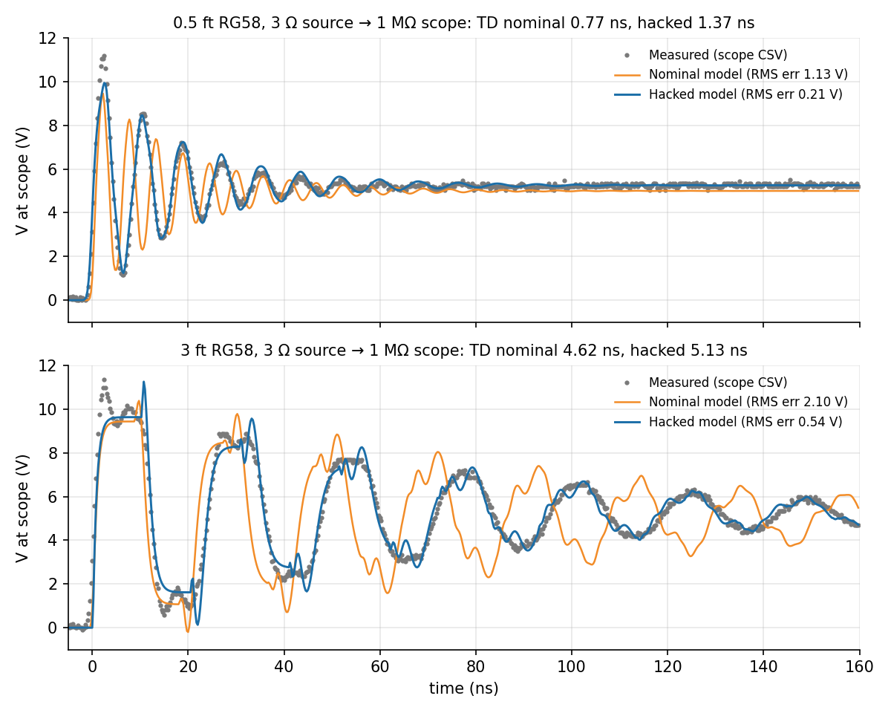
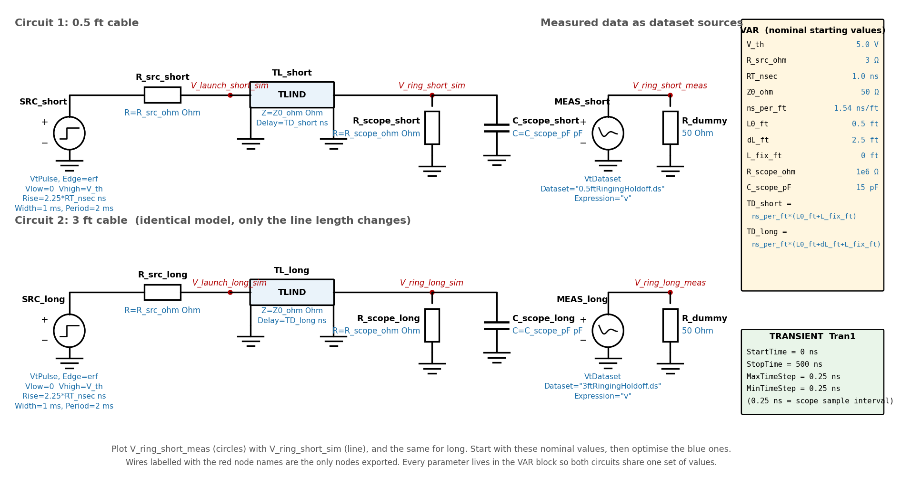

# Lab 1.3 - Hacking Ringing Reflections in Coax Cables

**Course:** ECEN 5534 - HSDE Measurement, Simulation, Analysis, and Presentation Skills  
**Date:** Fall 2026  
**Team:** Leo Marcinkus and Jordan Bernhardt  

## Overview

This lab took measured ringing waveforms from two lengths of the same
coax cable and fit a single transmission-line model to both. The model
started from nominal datasheet values, then its parameters were "hacked"
until the simulated waveform matched the measurement, which reveals what
the nominal model leaves out.

  

## Technical Objectives

- Capture clean ringing waveforms on 0.5 ft and 3 ft RG58 cables
- Import the scope data into Keysight ADS as a dataset source
- Build one parameterized model shared by both cable lengths
- Compare the nominal model against the measurement
- Adjust the model parameters to fit, and interpret what the fitted
  values mean physically

## Setup and Measurement

- Source: 3 Ω output at 5 V driving RG58 coax into the scope's 1 MΩ input
  with no probe
- Scope: Keysight DSOX4024A, 5 GSa/s, 200 MHz, 50 ns/div for both cables
  so the two data sets share one time base
- Trigger holdoff and a low trigger threshold put the start of the edge
  just before t = 0, since ADS only plots t ≥ 0
- 2000 points at 0.25 ns per sample saved as CSV, with the time base long
  enough to show the steady state

## Measured Ringing

| Feature | 0.5 ft | 3 ft |
|---|---|---|
| 1st peak / steady state | 11.09 V / 5.24 V | 11.11 V / 5.22 V |
| Ring period | 8.3 ns | 24.5 ns |
| Effective TD (period / 4) | 2.1 ns | 6.1 ns |
| Cable-only TD (1.54 ns/ft) | 0.77 ns | 4.6 ns |
| Extra delay (fixture and scope C) | 1.3 ns | 1.5 ns |
| Rsrc from decay | 3.7 Ω | 3.0 Ω |

The difference between the two cables gives (6.1 - 2.1) ns / 2.5 ft =
1.6 ns/ft, consistent with Lab 1.2. Both cables carry the same ≈ 1.3 to
1.5 ns of extra delay from the SMA-BNC adapter, connectors, and scope
input capacitance. The decay rate implies an effective source resistance
of 3 to 4 Ω, above the 1.7 Ω DC value from Lab 1.1, because a lossless
model has to put the cable loss somewhere.

## Model

  

Both circuits use the same erf-edge source, series source resistance,
ideal transmission line, and scope R and C, with every parameter held in
one variable block so the two cables share a single set of values. The
measured waveforms enter as dataset sources so model and measurement
plot on the same axes. The transient step matches the 0.25 ns scope
sample interval.

## Results

| Cable | Nominal TD | Fitted TD | Nominal RMS error | Fitted RMS error |
|---|---|---|---|---|
| 0.5 ft | 0.77 ns | 1.37 ns | 1.13 V | 0.21 V |
| 3 ft | 4.62 ns | 5.13 ns | 2.10 V | 0.54 V |

The nominal model rings at the wrong period and drifts out of phase
within a few cycles. Lengthening the delay to include the fixture, with
the other shared parameters adjusted alongside it, keeps the fitted model
in phase across the plotted 160 ns window on both cables.

## Key Takeaways

- The first rule of importing measured data: it must look exactly like
  the scope screen before any model is added
- A model fitted to two lengths at once separates per-length effects
  (cable delay) from fixed effects (fixture delay, scope capacitance)
- Fitted values that differ from nominal are information: here they
  quantify fixture delay and cable loss that the nominal model ignores

## Files

- `lab-1.3-presentation.pdf` - Setup, measurements, and ADS import procedure  
- `images/nominal-vs-hacked-fit.png` - Nominal and fitted model vs measurement  
- `images/ads-model.png` - Shared-parameter model for both cable lengths  

---

Part of the [ECEN 5534 measurement labs](../).
