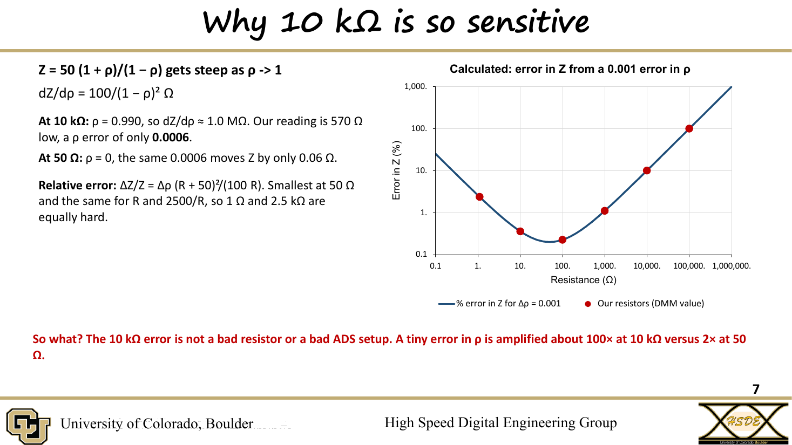
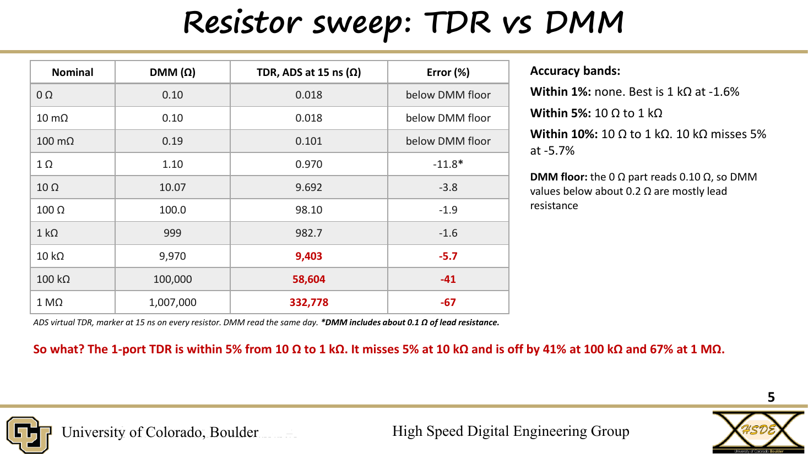

# Lab 2.1 - TDR from VNA Measurements

**Course:** ECEN 5534 - High-Speed Measurements  
**Date:** Fall 2026  

## Overview

This lab built a virtual TDR in Keysight ADS from 1-port VNA
measurements and asked a direct question: how accurately does it measure
impedance, and over what range of resistance can it be trusted?

SMA-mounted resistors from 0 Ω to 1 MΩ were measured with the VNA, run
through the virtual TDR, and compared against DMM readings of the same
parts. The accuracy limit was then traced to its root cause in the
instrument rather than written off as measurement error.

  

## Technical Objectives

- Build a TDR in ADS from measured S11 data
- Show the effect of calibrating at the end of the cable
- Measure the impedance accuracy against a DMM reference across six
  decades of resistance
- Explain the loss of accuracy at high impedance quantitatively
- Compare the result against published usable ranges for 1-port methods

## Setup

- Instrument: NanoVNA-F V3, 1-port, SOLT calibrated at the end of the
  cable, 801 points, 7.49 MHz start and step, up to 6 GHz
- DUTs: SMA-mounted resistors from 0 Ω to 1 MΩ and a 50 Ω load
- Reference: DMM resistance of every resistor, measured the same day
- Analysis: .s1p files imported into an ADS virtual TDR, every value read
  at 15 ns

## How the Virtual TDR Works

- A 2 V source drives a matched 50 Ω line, so 1 V is launched and
  ρ = V_TDR - 1
- Impedance is computed as Z = 50 (1 + ρ) / (1 - ρ)
- An erf edge with a 10-90 rise of about 0.17 ns (1/BW) avoids Gibbs
  ringing from a faster edge than the data supports
- Sweep start equal to the step (7.49 MHz) means ADS never interpolates

The measured S11 becomes a behavioral model, so any TDR can be built after
the measurement, limited only by the VNA bandwidth and frequency step.

## Results

**Calibration plane:** without calibration at the cable end, a 50 Ω load
read 51.7 Ω and drifted between 51 and 52 Ω because the cable was part of
the DUT. With calibration, the same load read 50.01 Ω and stayed flat.

| Nominal | DMM | Virtual TDR at 15 ns | Error |
|---|---|---|---|
| 10 Ω | 10.07 Ω | 9.692 Ω | -3.8% |
| 100 Ω | 100.0 Ω | 98.10 Ω | -1.9% |
| 1 kΩ | 999 Ω | 982.7 Ω | -1.6% |
| 10 kΩ | 9,970 Ω | 9,403 Ω | -5.7% |
| 100 kΩ | 100,000 Ω | 58,604 Ω | -41% |
| 1 MΩ | 1,007,000 Ω | 332,778 Ω | -67% |

- **Within 5%:** 10 Ω to 1 kΩ, with flat plateaus that settle within ~5 ns
- **10 kΩ:** never settles, wandering ±4% on a single sweep
- **Below 1 Ω:** the DMM's own ~0.1 Ω lead resistance dominates

  

## Why Accuracy Falls Off

Z = 50 (1 + ρ) / (1 - ρ) gets steep as ρ approaches 1, with
dZ/dρ = 100 / (1 - ρ)². At 10 kΩ, ρ = 0.990 and dZ/dρ ≈ 1 MΩ, so the
570 Ω miss corresponds to a ρ error of only 0.0006. The same ρ error at
50 Ω moves Z by just 0.06 Ω. Relative error is smallest at 50 Ω and
symmetric between R and 2500/R.

The VNA cannot resolve ρ that close to 1. Its S11 spec is 50 dB at
1.5 GHz, a ρ floor of about 0.003, or about ±3 kΩ at 10 kΩ. Measured
|S11| even rose above 0 dB on the 10 kΩ part, which a passive resistor
cannot do. The 570 Ω error is the size the instrument's own resolution
predicts.

This agrees with Sandler, "Extending the usable range of the 2-port shunt
through impedance measurement" (IEEE LAMC 2016), which gives 1 Ω to
2 kΩ as the usable 1-port range. The measured 5% band sits inside it.

## Key Takeaways

- A VNA plus ADS is a working TDR: the 50 Ω cal load reads 50.01 Ω and
  10 Ω to 1 kΩ reads within 5% of a DMM
- Every impedance is referenced to the calibration plane
- Know the range an instrument is accurate over before trusting a number
  from it. Measuring 10 kΩ and above well requires a 2-port series method,
  not better post-processing

## Files

- `Lab2.1_Marcinkus.pdf` - Final presentation  
- `images/` - Key slides  

---

Part of the [ECEN 5534 measurement labs](../).
