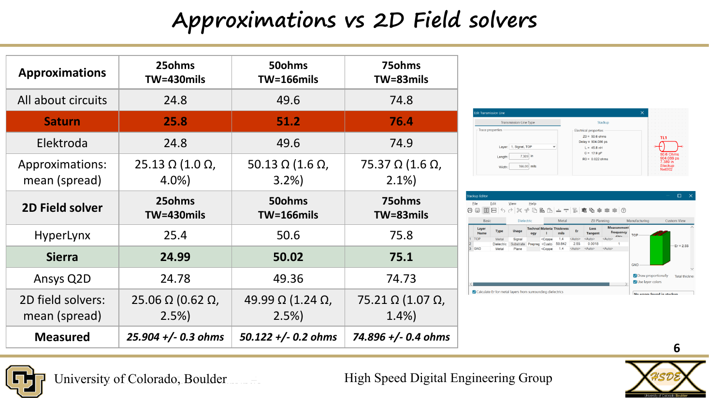
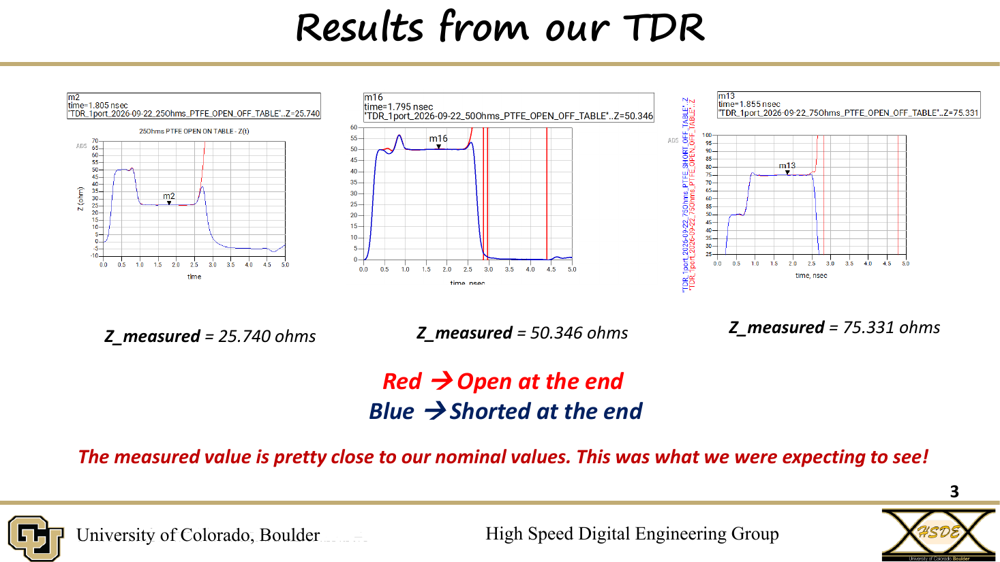

# Lab 2.2 - Measuring the Z0 of PCB Traces on PTFE

**Course:** ECEN 5534 - HSDE Measurement, Simulation, Analysis, and Presentation Skills  
**Date:** Fall 2026  
**Team:** Leo Marcinkus, Ruban Ford Alfred, and Alex Martinez  

## Overview

This lab measured the characteristic impedance of 25 Ω, 50 Ω, and 75 Ω
microstrip traces on a PTFE test board with a VNA-based virtual TDR, then
asked whether online calculators and 2D field solvers predict what was
measured, and how well they agree with each other.

The same nominal stackup was entered into six tools, and the sensitivity
of Z0 to each input was combined with realistic manufacturing tolerances
to show how much spread a real board should be expected to have.

  

## Technical Objectives

- Measure Z0 of three microstrip traces with a virtual TDR
- Quantify the ripple along each trace as the measurement uncertainty
- Show how the measurement environment changes the result
- Compare measurement against three online calculators and three 2D field
  solvers using identical inputs
- Calculate the sensitivity of Z0 to trace width, thickness, dielectric
  thickness, and Dk, and scale it by manufacturing tolerances

## Setup

- DUT: CU HSDE PTFE Transmission Line V2.0 board, uncoated microstrip
  with no solder mask
- Nominal inputs in every tool: Dk = 2.55, H = 1.52 mm (59.8 mil),
  t = 1.4 mil
- Instrument: calibrated 1-port VNA, 801 points with start equal to
  step, .s1p files into an ADS virtual TDR
- Conditions: far end open and shorted; board flat on the table with
  traces down, and on its edge with traces in air

## Results

  

| Trace (width) | Measured Z0 | Calculators, mean | 2D field solvers, mean |
|---|---|---|---|
| 25 Ω (430 mil) | 25.9 ± 0.3 Ω | 25.13 Ω | 25.06 Ω |
| 50 Ω (166 mil) | 50.1 ± 0.2 Ω | 50.13 Ω | 49.99 Ω |
| 75 Ω (83 mil) | 74.9 ± 0.4 Ω | 75.37 Ω | 75.21 Ω |

- **Calculators:** All About Circuits, Saturn PCB Toolkit, and Elektroda.
  Two gave identical results, which means they use the same closed-form
  equation; Saturn alone differed
- **2D field solvers:** Siemens HyperLynx, Sierra Circuits, and Ansys Q2D,
  with a tighter spread than the calculators on every trace (2.5%, 2.5%,
  and 1.4% vs 4.0%, 3.2%, and 2.1%)
- **Uncertainty:** ± is half the plateau ripple between the highest and
  lowest TDR markers, about ±0.2 to 0.4 Ω or roughly 1% of nominal

## The Table Is Part of the DUT

With the trace facing down on the table, the table material replaces the
air above the microstrip (Dk = 1). That raises the effective Dk and lowers
Z0 by up to about 1.1 Ω, two to four times the measurement uncertainty.
Where the board sits during measurement changes the answer.

## Sensitivity to Inputs (50 Ω trace, ±1% change)

| Input | ΔZ0 for 1% change | Relative sensitivity |
|---|---|---|
| Trace width | -0.326 Ω | -0.65 |
| Dielectric thickness | +0.330 Ω | +0.66 |
| Dk | -0.213 Ω | -0.43 |
| Trace thickness | -0.003 Ω | -0.007 |

Width and dielectric thickness dominate. A 1% fabrication tolerance on
either moves Z0 by more than the measurement ripple, while copper
thickness is negligible for a trace this wide.

## Manufacturing Tolerance (50 Ω trace)

Multiplying each sensitivity by a realistic fabrication tolerance shows
the spread a real board should have:

| Tolerance case | Width | Dielectric H (±2 mil) | Copper t (15%) | Dk (±0.04) | Total ΔZ0 |
|---|---|---|---|---|---|
| Loose width (20%) | ±6.51 Ω | ±1.10 Ω | ±0.05 Ω | ±0.33 Ω | ±8 Ω |
| Tight width (5%) | ±1.63 Ω | ±1.10 Ω | ±0.05 Ω | ±0.33 Ω | ±2 Ω |

With a 5% width tolerance, the 2D solvers predict 50.02 ± 2 Ω. The
measured 50.12 ± 0.2 Ω falls well inside that band, and so does every
calculator and field solver result.

## Key Takeaways

- A calibrated virtual TDR resolves trace impedance to a few tenths of an
  ohm, enough to distinguish between calculators and field solvers
- Calculators that agree with each other may simply share a formula;
  agreement is not independent validation
- The measurement environment, including the bench surface, can shift Z0
  by more than the measurement uncertainty
- Fabrication tolerance on width and dielectric height matters more than
  which solver is used: the ±2 Ω manufacturing band is wider than the
  spread between any of the six tools

## Files

- `lab-2.2-presentation.pdf` - Final presentation  
- `images/` - Key slides  

---

Part of the [ECEN 5534 measurement labs](../).
