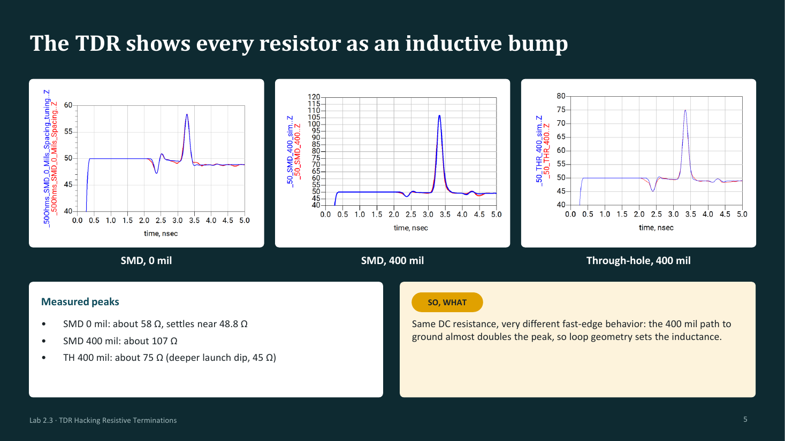
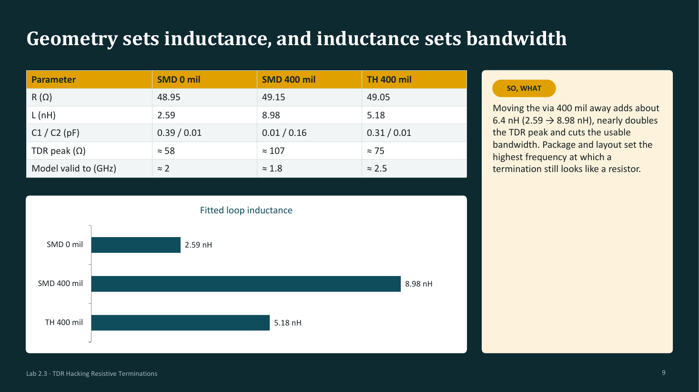

# Lab 2.3 - TDR Hacking Resistive Terminations

**Course:** ECEN 5534 - HSDE Measurement, Simulation, Analysis, and Presentation Skills  
**Date:** Fall 2026  
**Team:** Leo Marcinkus, Ruban Ford Alfred, and Alex Martinez  

## Overview

This lab measured three 50 Ω terminations that have the same DC
resistance but different geometry: a surface-mount resistor with its via
right at the pad, a surface-mount resistor 400 mil from its via, and a
through-hole resistor 400 mil away. Each was measured with a VNA-based
virtual TDR and fit with the same small R, L, C model, so every
difference between the cases traces back to the resistor and its loop
to ground.

  

## Technical Objectives

- Measure the fast-edge behavior of resistive terminations with a TDR
- Calibrate a fixture model (adapter, SMA, and launch line) on an open
  standard before modeling any resistor
- Fit one consistent C1 - R - C2 - L model to every termination
- Compare model and measurement in both the time and frequency domains
- Determine how far up in frequency each model remains valid

## Setup

- Instrument: NanoVNA-F V3, 1 MHz to 6 GHz, S11 dynamic range 50 dB,
  1-port SOL calibration at the SMA reference plane
- DUTs: open standard, SMD 50 Ω at 0 mil and 400 mil from the via, and
  through-hole 50 Ω at 400 mil
- Virtual TDR in Keysight ADS: 0 to 2 V step behind 50 Ω with a 1 ns
  lead-in line, Z(t) = 50·V / (2 - V)
- Rise time: 6 GHz bandwidth gives a 10-90 rise of about 167 ps, set in
  ADS as an erf edge of 2.23 / BW ≈ 372 ps (0-100)

A 167 ps edge resolves features about 540 mil apart on microstrip;
anything under about 180 mil behaves as a lumped element.

## Method

**Fixture first.** The open standard was used to fit the fixture: 0.085 ns
adapter delay, 0.188 pF and 269 pH for the SMA, 0.0475 ns SMA delay, and
a 400 x 2500 mil microstrip line. The model tracks the open within about
0.5 Ω through the SMA dip (47.5 Ω) and bump (51.5 Ω), and those values
became the starting point for every resistor case.

**One resistor model.** Each termination is modeled as C1 (pad
capacitance at the launch), R (DC value), and C2 plus L (body and loop
to ground). Only those elements change between cases. Measurement and
model are compared through Z = 50 (1 + S11) / (1 - S11), with the
similarity metric |Z_meas - Z_sim| across frequency.

## Results

  

| Parameter | SMD 0 mil | SMD 400 mil | TH 400 mil |
|---|---|---|---|
| R | 48.95 Ω | 49.15 Ω | 49.05 Ω |
| L | 2.59 nH | 8.98 nH | 5.18 nH |
| C1 / C2 | 0.39 / 0.01 pF | 0.01 / 0.16 pF | 0.31 / 0.01 pF |
| TDR peak | ≈ 58 Ω | ≈ 107 Ω | ≈ 75 Ω |
| Model valid to | ≈ 2 GHz | ≈ 1.8 GHz | ≈ 2.5 GHz |

- **SMD, 0 mil:** TDR peak about 58 Ω, settling near 48.8 Ω. |S11| within
  about 1 dB and |ΔZ| under about 5 Ω up to 2 GHz. Above about 3 GHz the
  impedance resonances shift and |ΔZ| exceeds 30 Ω as parasitics outside
  the model take over
- **SMD, 400 mil:** TDR peak about 107 Ω, matched by the model. The longer
  loop makes |Z| sharply resonant, so the resonance frequencies line up to
  about 3 GHz but small frequency offsets produce large |ΔZ| at each peak.
  |ΔZ| stays under about 15 Ω to 1.8 GHz
- **Through-hole, 400 mil:** TDR peak about 75 Ω with a deeper 45 Ω launch
  dip. Lower inductance than the SMD at the same spacing (5.18 vs
  8.98 nH). |S11| within about 1 dB to 3 GHz and |ΔZ| under about 10 Ω to
  2.5 GHz

## Key Takeaways

- Every resistor shows up on a TDR as an inductive bump; same DC
  resistance, very different fast-edge behavior
- Moving the via 400 mil away adds about 6.4 nH, nearly doubles the TDR
  peak, and cuts the usable bandwidth
- Calibrating the fixture on a known standard first means the fitted
  values describe the resistor, not the connector
- Package and layout set the highest frequency at which a termination
  still looks like a resistor

## Files

- `lab-2.3-presentation.pdf` - Final presentation  
- `images/` - Key slides  

---

Part of the [ECEN 5534 measurement labs](../).
