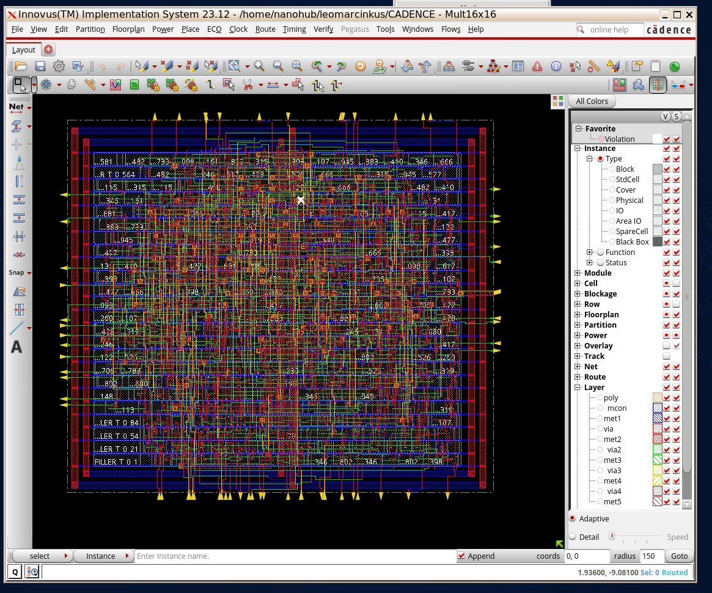
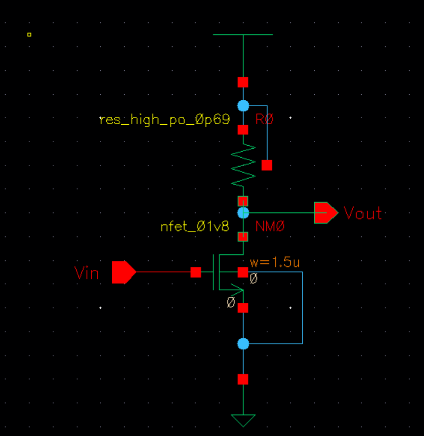
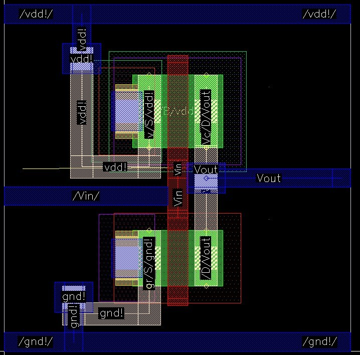
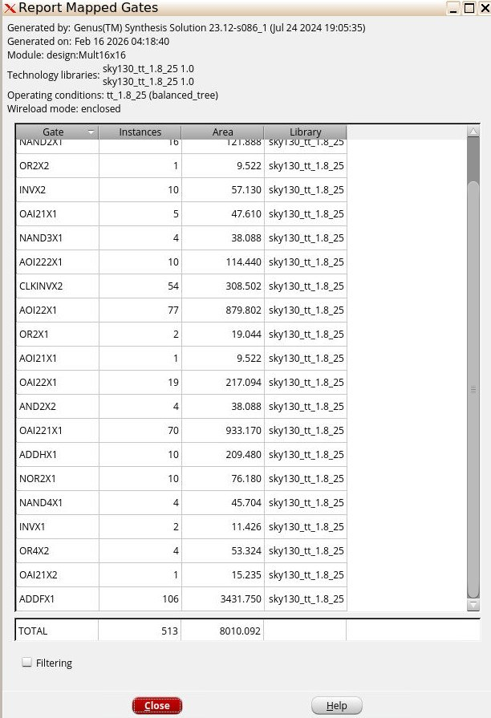
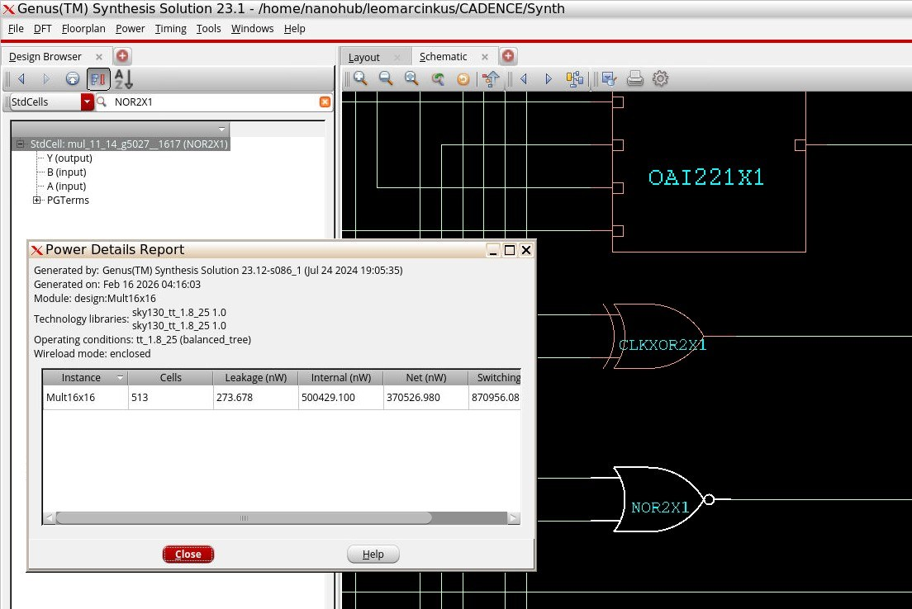

# Cadence sky130 Tool Flow Labs

**Course:** ECEN 4012 - Design of VLSI Circuits  
**Date:** Spring 2026  

## Overview

These lab tutorials covered both IC design flows used in the course on
the SkyWater sky130 process with Cadence tools on nanoHUB: the full-custom
flow (schematic, layout, extraction, and post-layout simulation in
Virtuoso) and the pushbutton flow (RTL synthesis in Genus and place and
route in Innovus).

  

## Full-Custom Flow (Virtuoso)

### Schematic and Simulation
A CMOS inverter and a resistively loaded common-source amplifier were
drawn with sky130 devices (nfet_01v8, res_high_po) and simulated in
Spectre.

  

### Layout, Extraction, and PCells
The inverter was laid out by hand, with poly gate, diffusion, contacts,
metal routing, substrate tap, and n-well tap. The extracted view was then simulated to include layout parasitics,
and the same circuit was rebuilt with parameterized cells (PCells).

  

## Pushbutton Flow (Genus and Innovus)

A 16 x 16 combinational multiplier was written in SystemVerilog,
synthesized with Cadence Genus to the sky130 9-track standard-cell
library using a Tcl script, and then placed and routed in Innovus.

| Synthesis result | Value |
|---|---|
| Standard cells | 513 |
| Total cell area | ≈ 8,010 µm² |
| Leakage power | 273.7 nW |
| Switching power | 871 µW |
| Corner | tt, 1.8 V, 25 °C |

  
  

## Key Takeaways

- Full custom gives control over every device and wire and is used where
  performance or matching matters, at the cost of design time
- The pushbutton flow trades that control for speed: a few lines of RTL
  became a 513-cell placed and routed block
- Parasitic extraction is what connects a drawn layout to a trustworthy
  simulation; the schematic alone misses the wiring capacitance

## Tools

- Cadence Virtuoso, Spectre, Genus, and Innovus on nanoHUB
- SkyWater sky130 PDK and sky130 9-track standard-cell library
- SystemVerilog and Tcl

---

These flows were applied in the [VGA/AGC mixed-signal design](../vga-agc-mixed-signal/).
For a Tanner-based full-custom project, see the
[1T-1C DRAM cell](../dram-1t1c-sense-amplifier/).
