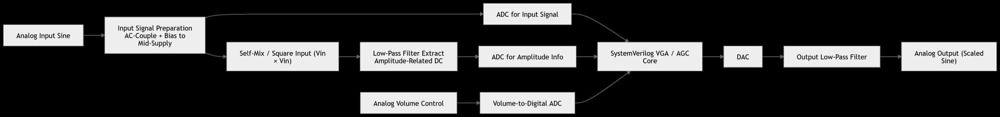
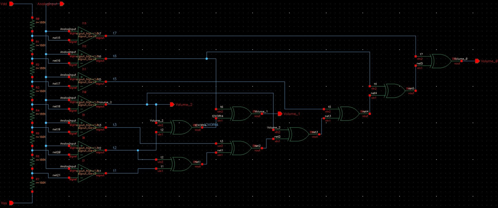
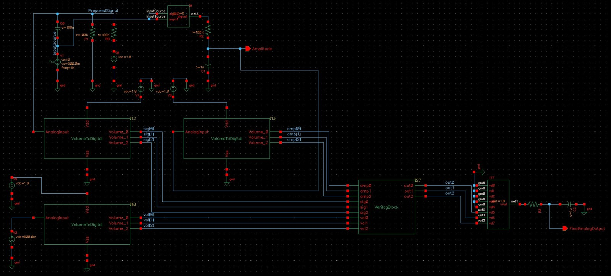
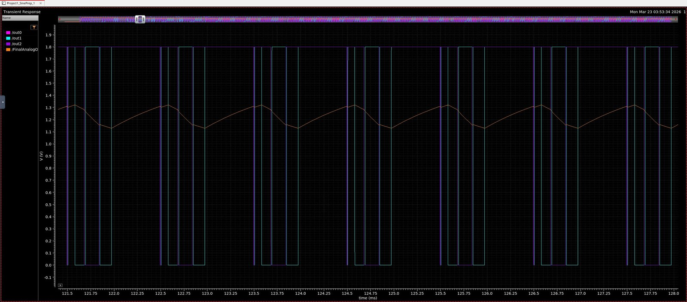

# Mixed-Signal VGA/AGC with Flash ADCs and a Verilog-A Gain Core

**Course:** ECEN 4012 - Design of VLSI Circuits  
**Date:** Spring 2026  

## Overview

This project is a variable gain amplifier with automatic gain control,
built as a mixed-signal system in Cadence Virtuoso on the SkyWater sky130
process (0 to 1.8 V). It takes the "more Verilog, less analog" approach:
instead of adjusting gain with analog circuitry, the input signal, its
amplitude, and a volume setting are each digitized, the gain is computed
in a behavioral digital core, and the result is converted back to analog.

  

## Technical Objectives

- Condition an analog sine input into the 0 to 1.8 V operating range
- Estimate input amplitude with a self-mix (squarer) and low-pass filter
- Design a 3-bit flash ADC and use it for the signal, amplitude, and
  volume paths
- Implement the gain law digitally and convert the result back to analog
- Simulate the full mixed-signal system in Spectre

## System Architecture

| Block | Implementation | Function |
|---|---|---|
| Input preparation | Semi-custom | 100 nF AC coupling and a 100 kΩ / 100 kΩ divider biasing to 0.9 V mid-supply |
| Amplitude estimate | ahdlLib multiplier + RC | Squares the prepared signal (gain 8); a 100 kΩ / 1 µF low-pass keeps the DC term proportional to amplitude² |
| Flash ADCs (x3) | Semi-custom | Resistor ladder, seven comparators, and an XOR encoder giving a 3-bit code for signal, amplitude, and volume |
| VGA/AGC core | Verilog-A | out = (sig × vol) / amp, with a divide-by-zero guard and saturation at 7 |
| DAC | ahdlLib 8-bit ideal | 3-bit result drives the three MSBs to use the full output range |
| Output filter | Semi-custom | 1 kΩ / 1 µF low-pass smoothing the stepped DAC output |

  

The core was first written in SystemVerilog and taken through the
digital Cadence tools, but the installed Xcelium version was incompatible
with Virtuoso's mixed-signal import flow, so the block was rewritten in
Verilog-A to simulate directly in Spectre.

## Full System

  

## Results

  

- The full chain works end to end: a 1 kHz analog sine is digitized,
  scaled in the Verilog-A core, and reconstructed as an analog sine
  oscillating between about 1.1 and 1.3 V
- The output bits toggle correctly with the scaled signal, and DAC steps
  are visible as small discontinuities smoothed by the output filter
- Over a 1 s simulation, the output amplitude steps down through four
  levels (about 1.55 V to 1.2 V) as the amplitude estimate charges and
  the amplitude code climbs from 1 to 4, then settles after about 250 ms.
  This is the AGC reducing gain as measured input amplitude rises

## Known Limitations

- Three-bit ADCs give only eight levels, so the reconstructed sine is
  jagged, and raising the volume input from 0.9 V to 1.35 V produced
  little measurable change in output amplitude
- The ADCs are unclocked, so the system samples continuously, which adds
  noise at the DAC output
- One bit of the volume ADC sat at 0.9 V instead of a logic level; the
  block still encoded volume correctly through the other bits, but the
  root cause was not found

## Lessons Learned

- An existing ideal 8-bit ADC in ahdlLib would have given far better
  resolution than the custom 3-bit flash ADC, and should have been the
  starting point
- Mixed-signal simulation depends on tool compatibility as much as on the
  design; moving the core to Verilog-A was what made the system simulate
- Building and verifying each block separately before integration made
  the full-system debug manageable

## Tools

- Cadence Virtuoso and Spectre (AMS) on nanoHUB
- SkyWater sky130 PDK
- Verilog-A and Cadence ahdlLib behavioral models

## Files

- `VGA_AGC_Report_Marcinkus.pdf` - Full project report with block-level
  schematics, simulations, and Verilog-A code  
- `images/` - Block diagram, ADC and full-system schematics, output
  waveform  

---

For related work, see the [1T-1C DRAM cell](../dram-1t1c-sense-amplifier/)
and [Cadence sky130 tool flow labs](../cadence-sky130-labs/) in this
repository.
